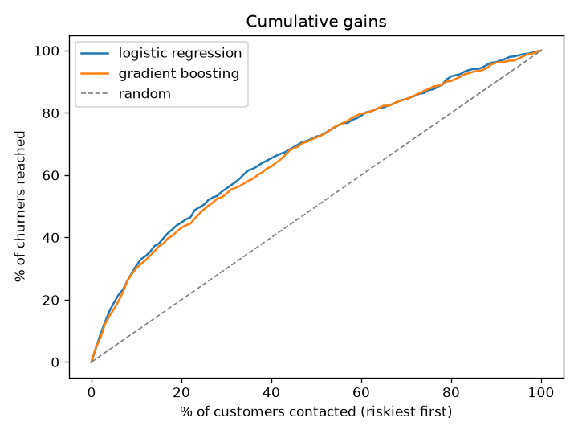
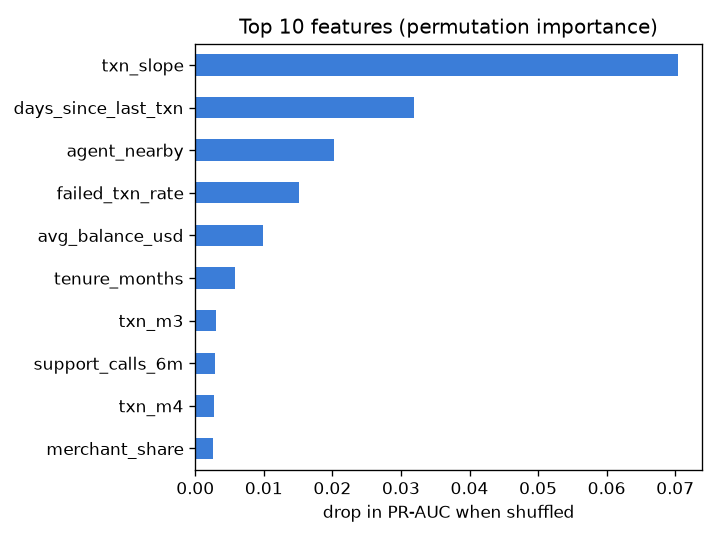

# mobile-money-churn

Which wallet customers are about to stop transacting?

In mobile money, people rarely close their accounts. They just stop using them. So "churn" here means a customer who was active at some point in the last six months and then has no transactions at all in the next 60 days. If we can flag those people early, a retention team can reach them with a call, a fee waiver, or a nudge to a nearby agent before they go.

**The data is simulated.** I can't share real customer data, so `simulate.py` builds a 20,000 customer base with the same shape as what I work with: monthly transaction counts, balances, P2P vs merchant mix, failed transaction rate, support calls, region, and whether there's an agent close by. Churn is driven by a few of those plus a lot of noise, so the problem isn't trivially easy.

## Run it

```
uv sync
uv run python -m mobile_money_churn.train
uv run pytest
```

That trains both models, writes `reports/metrics.json` and saves the charts to `reports/figures/`.

## Results

Held-out 25% of customers, churn rate about 12%:

| model | ROC AUC | PR AUC | churners caught in top 10% | top 20% |
|---|---|---|---|---|
| logistic regression | 0.70 | 0.29 | 31% | 45% |
| gradient boosting | 0.69 | 0.27 | 30% | 43% |

The number I care about is the capture rate. If the team only has budget to call 10% of the base, calling the top 10% by score reaches about 3x as many churners as calling people at random.



The boosted model doesn't beat logistic regression here. That isn't surprising, because I generated churn from a mostly linear relationship, so a linear model is already the right shape. On real data I'd expect the gap to go the other way. Either way I'd keep the logistic model around as a baseline, since it's much easier to explain to the business side.

The activity trend (`txn_slope`) and days since the last transaction carry most of the signal. Having an agent nearby comes next, ahead of failed transactions. The raw monthly counts barely matter once the slope is there:



## Layout

```
src/mobile_money_churn/
  simulate.py   fake customer base
  features.py   activity trend features
  train.py      models, metrics, charts
tests/
reports/
```

## Things I'd do next

- Calibrate the probabilities so a score of 0.3 actually means about a 30% chance
- Put a cost on each retention offer and choose the cut-off by expected profit, not a fixed 10%
- Time-based split (train on earlier months, test on later) once there's more than one snapshot
- Check whether the model is less accurate for rural customers, who look different on almost every feature
